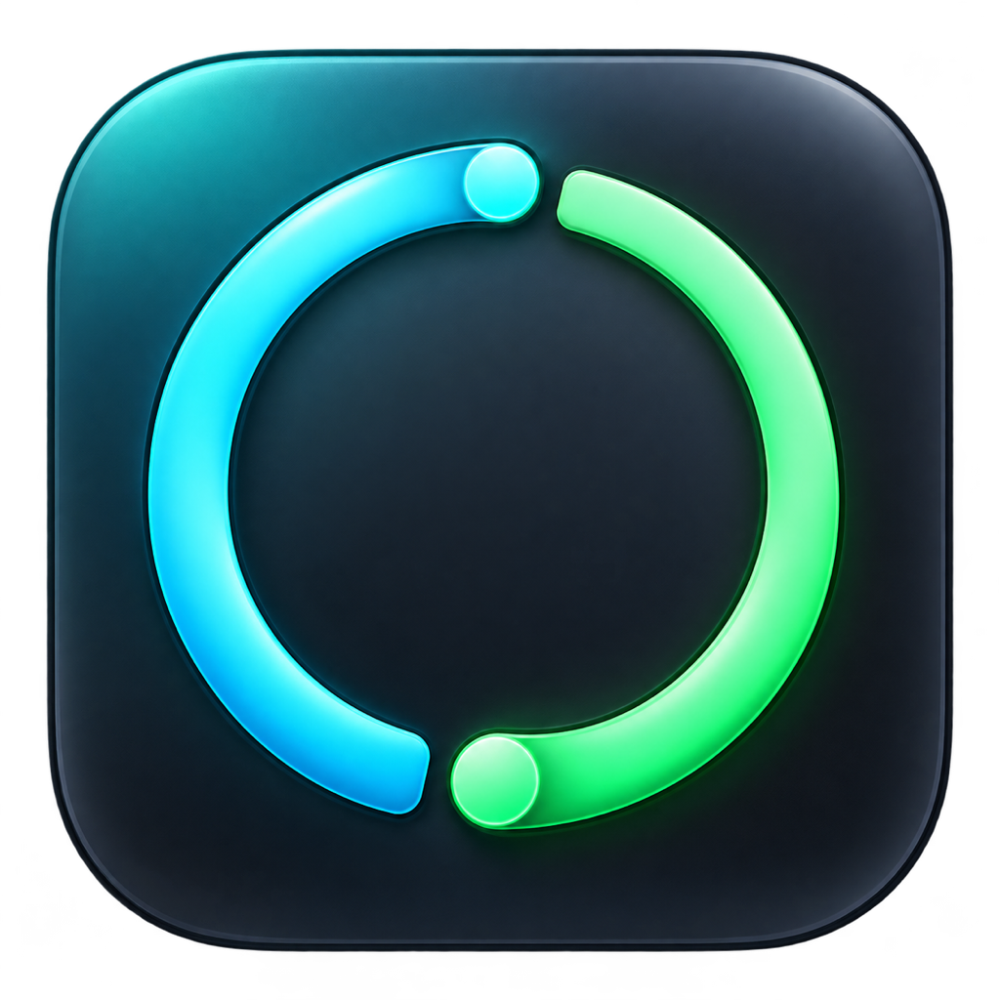
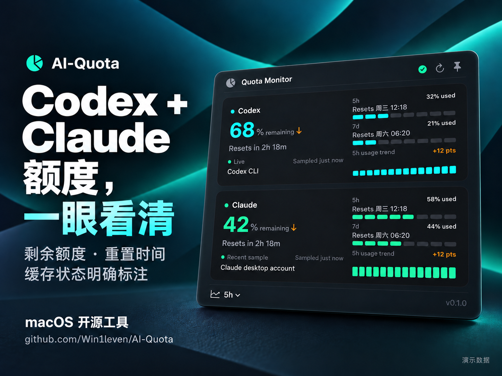

<p align="center"></p>

# AI-Quota

一个原生 macOS 菜单栏与桌面胶囊工具，把 **Codex 和 Claude 的剩余额度、重置时间、数据来源与采样时间** 放在一起看。

<p align="center"></p>

<p align="center"><sub>宣传示意图（AI 生成，参考原生界面组件）；额度和日期均为虚构演示数据，实际显示以服务返回及当前版本为准。</sub></p>

## 直接下载安装

**首个测试版：v0.1.0-beta.1 · macOS 13+ · Apple Silicon / Intel 通用包**

- [下载 DMG 安装包](https://github.com/Win1leven/AI-Quota/releases/download/v0.1.0-beta.1/AI-Quota-0.1.0-beta.1-universal.dmg)
- [下载 ZIP 备用包](https://github.com/Win1leven/AI-Quota/releases/download/v0.1.0-beta.1/AI-Quota-0.1.0-beta.1-universal.zip)
- [测试版说明与 SHA256 校验文件](https://github.com/Win1leven/AI-Quota/releases/tag/v0.1.0-beta.1)

1. 打开 DMG，把 **AI-Quota.app** 拖到 **Applications（应用程序）**。
2. 从“应用程序”打开 AI-Quota。它默认常驻菜单栏，启动后没有普通主窗口。
3. 本测试版采用 ad-hoc 临时签名，**未经过 Developer ID 分发签名和 Apple 公证**。首次被系统拦截时，先尝试打开一次，再前往“系统设置 → 隐私与安全性 → 仍要打开”。仅确认来自本仓库且校验一致后继续；不要关闭整个系统的门禁。详见 [Apple 官方说明](https://support.apple.com/zh-cn/102445)。
4. 点击菜单栏入口查看详情，右键打开 Settings；也可以使用 `⌘,`。

安装应用不需要 Xcode、Swift、Python 或编译源码；账户数据源另需如下配置。

## 首次使用

| 服务 | 需要什么 | 如何配置 |
| --- | --- | --- |
| Codex | 已安装并登录的 Codex CLI（`codex`） | 应用会查找常见路径；找不到时在 Settings → Codex 设置可执行文件路径。应用本身不附带 Codex，也不提供登录页面，参见 [Codex CLI 官方说明](https://developers.openai.com/codex/cli/)。 |
| Claude 桌面端 | 已安装并登录 Claude 桌面应用 | Settings → Claude，手动开启 **Read quota and reset times from desktop login**。默认关闭。可能出现 macOS 钥匙串访问提示。 |
| Claude Code（可选） | Claude Code、PATH 中可用的 `python3` | Settings → Claude → **Install / Enable**，完成一次正常 Claude Code 回复后采集。无需同时开启桌面会话访问。 |

**只使用 Claude 桌面端也能获取额度与重置时间**，前提是开启桌面登录访问且账户接口返回相应数据。未开启时，本地桌面历史可以显示缓存额度，但不包含重置时间。

设置 → General → **Display** 可选择菜单栏、桌面胶囊或同时显示。胶囊常驻显示两个服务的已知最低剩余额度；点击打开详情，拖动改变位置，右键可以刷新、打开设置或退出。

## 数据如何解读

- `Live / Recent sample`：近期取得的服务数据；看 `Sampled` 确认实际采样时间。
- `Cached / Stale`：缓存或较旧样本。刷新文件、重启应用不等于重新获得服务数据。
- 重置时间仅显示服务提供的值；不会通过 token 数推算。Claude 尚未开始的 5 小时窗口会显示“等待第一条消息”，不会虚构倒计时。
- 胶囊中的橙色标记表示缓存或刷新警告。未知额度不显示为 0%。
- 本地 token 统计与 API 等价估算不是订阅额度，也不是实际账单。

完整步骤、故障排查、卸载与数据位置请看 **[中文使用说明](docs/USAGE.zh-CN.md)**。

## 隐私与测试版边界

额度快照、设置和用量统计存储在本机。统计会读取本地会话文件中的 usage 字段；聊天内容不上传。Codex 使用现有登录进行额度/统计请求。Claude 桌面登录访问默认关闭，开启后只读取必要的本地 Cookie 与 Claude Safe Storage 钥匙串项，向固定的 `claude.ai` usage 地址发送必要会话 Cookie；凭据仅留内存，不导出或写入应用数据文件。旧的自动 Claude Code 凭据探测与 Anthropic 网络统计已移除。

这是 **公开测试版**。私有 Claude 接口、Cookie 格式和第三方 CLI 更新可能影响兼容性；实际重置边界仍待进一步验证。Intel 版本已交叉编译及静态验证，实际启动验收在 Apple Silicon 上完成。暂不支持自动更新与开机启动，应用界面目前主要为英文。

## 从源码构建

macOS 13+，Swift 6 / Xcode，无外部 Swift 包依赖。

```sh
swift test
./build.sh 0.1.0 1
./make-dmg.sh v0.1.0-beta.1
```

输出在 `dist/`，Universal app、DMG、ZIP 与 SHA256SUMS。构建不会覆盖已安装的应用或修改 Claude 的全局配置。

[项目进度与验证记录](docs/PROGRESS.md) · [项目上下文](docs/PROJECT_CONTEXT.md) · [反馈问题](https://github.com/Win1leven/AI-Quota/issues)

English: Native macOS quota monitor for Codex and Claude, with menu-bar and desktop capsule display. Download the prerelease above; it is ad-hoc signed and not notarized. Claude desktop-session access is opt-in. [Chinese usage guide](docs/USAGE.zh-CN.md) includes installation and setup.
